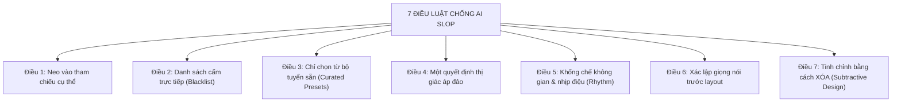

# Bộ Quy Tắc Chống Lối Mòn AI (Anti-AI-Slop Laws & Prompt Protocol)

Quy tắc này là **luật bắt buộc tuyệt đối** áp dụng cho mọi tác nhân AI khi thiết kế, tạo mới hoặc tinh chỉnh bất kỳ giao diện web/ứng dụng nào. Nguồn gốc quy chuẩn được trích xuất trực tiếp từ nghiên cứu thực chiến của **UI UX Pro Max** và **Anthropic Frontend Design Mastery**.

---

## 🚫 HIỆN TƯỢNG "AI SLOP" LÀ GÌ?
Khi không có quyết định dứt khoát từ con người, mô hình AI sẽ tự động **nội suy ra giá trị trung bình của toàn bộ internet**:
- Nền xám đen mờ mờ vô hồn hoặc nền trắng phẳng lặng.
- Gradient từ tím sang chàm/hồng lặp đi lặp lại khắp nơi.
- Font chữ mặc định: `Inter`, `Roboto`, `Open Sans`.
- 3 thẻ tính năng (feature cards) đặt ngang đều tăm tắp.
- Tiêu đề sáo rỗng: *"Thay đổi cách bạn làm việc"*, *"Cách mạng hóa quy trình"*.
- Soft drop shadow nhờ nhờ, thiếu đường viền định hình sắc nét.

**Hậu quả:** Giao diện an toàn, bóng bẩy nửa vời, và người dùng quên ngay sau khi lướt qua.

---

## ⚖️ 7 ĐIỀU LUẬT BẤT BIẾN CHỐNG AI SLOP (THE 7 LAWS)



---

### ĐIỀU 1: Neo Vào Một Tham Chiếu Cụ Thể (Specific Anchor Reference)
- **CẤM:** Dùng các tính từ chung chung vô nghĩa như: *"làm cho hiện đại"*, *"giao diện sạch sẽ"*, *"thiết kế bắt mắt"*. AI không hiểu những từ này và sẽ tự nội suy ra mức trung bình của web.
- **BẮT BUỘC:** Thay chữ "hiện đại" bằng **một cái tên thương hiệu, một ấn phẩm hoặc một trường phái cụ thể**:
  - *Ví dụ 1:* "Xử lý như trang product của Linear cuối 2024 — tiêu đề sans-serif đậm, nhiều khoảng trắng, vạch ngăn mảnh 1px, gần như không có màu cho đến nút CTA."
  - *Ví dụ 2:* "Thiết kế theo phong cách tạp chí kiến trúc Kinfolk — giấy ngà thủ công Alabaster, chữ than củi tương phản cao, ảnh chụp khổ lớn, khoảng thở hào phóng."
  - *Ví dụ 3:* "Phong cách Wabi-Sabi Nhật Bản — than củi trầm ấm, gỗ tuyết tùng Hinoki, rêu phong matcha, tôn trọng sự tĩnh lặng."

---

### ĐIỀU 2: Danh Sách Cấm Trực Tiếp (Explicit Negative Blacklist)
Một danh sách cấm ngắn ở đầu chỉ dẫn có sức mạnh định hướng lớn hơn 3 đoạn văn mô tả tích cực. Khi bắt đầu viết CSS/HTML, AI **bắt buộc phải tuân thủ danh sách cấm sau**:

```yaml
DANH SÁCH CẤM TUYỆT ĐỐI (NEGATIVE BLACKLIST):
  - CẤM font: Inter, Roboto, Open Sans, Arial làm font nhận diện chính.
  - CẤM gradient: Tím sang chàm/hồng (Purple-to-indigo/pink gradient) sến sẩm vô căn cứ.
  - CẤM layout: 3 thẻ tính năng kích thước bằng nhau đặt ngang hàng trên nền trắng.
  - CẤM câu chữ: "Thay đổi cách bạn làm việc", "Nền tảng tất cả trong một", "Nâng tầm trải nghiệm".
  - CẤM hiệu ứng: Soft drop shadow mờ nhạt làm bẩn giao diện (thay bằng vạch kẻ 1px hoặc viền kính).
  - CẤM icon trang trí: Không gắn icon vào mọi ngóc ngách khi không có chức năng hành động.
```

---

### ĐIỀU 3: Chỉ Chọn Từ Bộ Đã Tuyển Sẵn (Curated Presets Only)
- Không bao giờ giao việc chọn màu sắc và font chữ cho một lần ngẫu hứng nội suy của AI.
- **BẮT BUỘC** áp dụng cú pháp presets từ thư viện **UI/UX Pro Max**:
  - `+style`: Chọn 1 trong 67 phong cách (Glassmorphism, Apple Bento Grid, Neo-Brutalism, Minimalist Luxury, Dark Cyber, Swiss International).
  - `+palette`: Chọn bảng màu theo ngành cụ thể (Kyoto Zen, Obsidian Neon, Nordic Sage, Warm Paper, FinTech Emerald, SaaS Royal).
  - `+font`: Chọn cặp font đã kiểm định thẩm mỹ (ví dụ: `Syne` + `Plus Jakarta Sans`, `Space Grotesk` + `Outfit`, `Cinzel` + `Newsreader`).

---

### ĐIỀU 4: Một Quyết Định Thị Giác Áp Đảo (One Dominant Visual Decision)
- Giao diện trung bình bị nhạt nhòa vì không có phần tử nào dám là **"thứ to nhất trong phòng"**. Mọi thứ cứ tranh nhau sự chú ý ở mức đều đều.
- **BẮT BUỘC:** Mỗi màn hình (viewport) phải có **1 quyết định thị giác áp đảo**:
  - *Hoặc:* Tiêu đề Hero đặt font Serif/Display kích thước cực lớn (72px - 96px), toàn bộ phần còn lại trên trang (body, button, vạch ngăn) lùi xuống 14px - 16px trung tính.
  - *Hoặc:* Một Canvas 3D / SVG Shader sống động làm trung tâm sân khấu (chiếm 60% không gian), toàn bộ danh sách chức năng phụ rút gọn vào sidebar bán trong suốt.
  - Tuyệt đối không để 5-6 khối nội dung tranh chấp độ đậm và kích thước ngang nhau.

---

### ĐIỀU 5: Khống Chế Không Gian & Nhịp Điệu (Spatial Rhythm & Grid)
- **80% cảm xúc của giao diện đến từ khoảng cách, đường căn và nhịp thở**, chứ không chỉ từ màu sắc.
- **Nguyên tắc nhịp điệu:**
  - Nhịp cơ sở: Bội số của `8px` (`8px`, `16px`, `24px`, `32px`, `48px`, `64px`, `96px`).
  - Phân cách khu vực: Dùng đường viền mảnh `1px solid rgba(255, 255, 255, 0.08)` (dark mode) hoặc `1px solid rgba(0, 0, 0, 0.08)` (light mode).
  - Bố cục bất đối xứng (Asymmetry): Khuyến khích chia cột lệch có chủ đích (ví dụ: cột trái 65% - cột phải 35%, hoặc Hero chiếm cột 2 đến cột 8 trên Grid 12 cột) thay vì luôn căn giữa thụ động.

---

### ĐIỀU 6: Xác Lập Giọng Nói Trước Khi Dàn Trang (Voice First, Layout Follows)
- Copywriter của AI thường đọc như bản đặc tả sản phẩm khô khan.
- **BẮT BUỘC:** Xác định **tông giọng (Tone of Voice)** của sản phẩm trước khi viết mã:
  - *Tông giọng trầm tĩnh & thiền tịnh:* Câu từ súc tích, tĩnh tại, ngắn gọn, giàu hình ảnh thiên nhiên.
  - *Tông giọng Developer / Data-Driven:* Lạnh lùng, chính xác, dùng thuật ngữ chuyên môn, không nói quá.
  - *Tông giọng Nghịch ngợm / Startup độc bản:* Cá tính, tự trào, gãy gọn, xưng hô thân mật.
- Nội dung và thông điệp phải được viết xong bằng giọng nói đó, sau đó layout mới được sinh ra để tôn vinh thông điệp.

---

### ĐIỀU 7: Tinh Chỉnh Bằng Cách XÓA (Subtractive Design)
- Khi người dùng phản hồi *"giao diện chưa đẹp"*, phản xạ sai lầm nhất của AI là cố nhồi nhét thêm hiệu ứng, thêm màu, thêm badge, thêm shadow.
- **QUY TẮC PHẪU THUẬT:** Khi lặp lại (iteration), **hãy XÓA trước khi THÊM**:
  1. Xác định 3 thứ đang hét lên "AI làm cái này" (gradient thừa, viền bo tròn thừa, badge trang trí vô nghĩa).
  2. Xóa bỏ chúng, trả lại khoảng trắng nguyên bản.
  3. Kiểm tra xem trang có đứng vững và thoáng đãng hơn không.
- **Châm ngôn gốc:**  
  > *"Mọi thứ bạn xóa đi mà không thấy nhớ — vốn dĩ là AI slop ngay từ đầu."*

---

## 📋 CHECKLIST KIỂM THỬ TRƯỚC KHI TRẢ CODE (PRE-FLIGHT AUDIT)

Trước khi gửi bất kỳ giao diện nào cho người dùng, AI phải tự kiểm tra 7 câu hỏi:
- [ ] 1. Giao diện này có bị rơi vào chữ ký tím/chàm lặp lại không?
- [ ] 2. Font chữ có bị dùng mặc định `Inter`/`Roboto` không? Đã thay bằng cặp font cá tính chưa?
- [ ] 3. Có layout 3 thẻ tính năng bằng nhau đặt ngang không? Đã chuyển sang Bento Grid hoặc bất đối xứng chưa?
- [ ] 4. Đâu là phần tử "to nhất trong phòng" trên màn hình này? Có bị tranh chấp thị giác không?
- [ ] 5. Có lạm dụng shadow nhòe nhoẹt không? Đã thay bằng viền kính 1px tinh tế chưa?
- [ ] 6. Bảng màu đã được neo vào một theme thực tế chưa (hay là AI tự đoán màu)?
- [ ] 7. Đã thực hiện bước "tỉa bớt các chi tiết thừa thãi" chưa?
