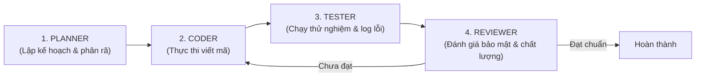

# Kỹ Năng: Agent Teams & Long-Running Tasks Orchestration

Kỹ năng này chuẩn hóa cách tổ chức nhiều AI Agent cùng phối hợp nhịp nhàng theo vai trò chuyên biệt, tránh tình trạng 1 agent đơn lẻ bị quá tải bộ nhớ context.

---

## 1. Mô Hình 4 Vai Trò Agent Chuyên Biệt



### Vai Trò 1: Planner Agent (Kiến Trúc Sư)
- **Nhiệm vụ:** Không viết code. Chỉ đọc yêu cầu, thiết kế kiến trúc hệ thống và chia nhỏ thành danh sách công việc tuần tự với tiêu chí hoàn thành rõ ràng.

### Vai Trò 2: Coder Agent (Kỹ Sư Triển Khai)
- **Nhiệm vụ:** Nhận 1 task duy nhất từ Planner, đọc mã nguồn hiện có và viết code triển khai với dung lượng diff nhỏ nhất.

### Vai Trò 3: Tester Agent (Kiểm Thử Viên)
- **Nhiệm vụ:** Chạy các lệnh build, unit test, hoặc tự động thao tác trên trình duyệt (qua Playwright/Puppeteer) để ghi lại kết quả thực tế. Nếu có lỗi, chuyển stack trace về cho Coder.

### Vai Trò 4: Reviewer Agent (Trưởng Nhóm Kỹ Thuật)
- **Nhiệm vụ:** Rà soát lỗ hổng bảo mật (SQL Injection, rò rỉ API key, quên RLS), kiểm tra chuẩn định dạng code (Prettier/ESLint) trước khi cho phép merge code vào nhánh chính.

---

## 2. Hướng Dẫn Tối Ưu Cho Từng Dòng Model

### 🌟 Dành cho Claude 3.7 / Antigravity / Cursor
- **Prompt mẫu:**
  ```text
  Theo skill `agent-teams-workflow`:
  Hãy đóng vai trò Reviewer Agent: Kiểm tra toàn bộ các thay đổi code vừa tạo, rà soát xem có rủi ro bảo mật hoặc lỗi tiềm ẩn nào không trước khi tôi tiến hành commit.
  ```
