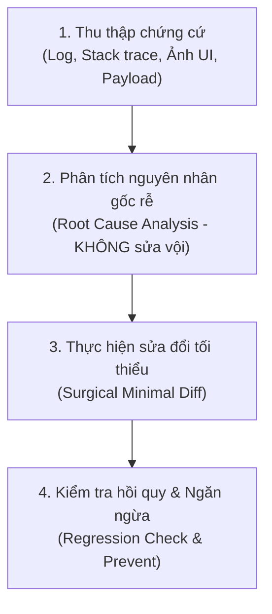

# Kỹ Năng: AI-Native Debugging Loop (Quy Trình Gỡ Lỗi Chuẩn)

Kỹ năng này giải quyết thói quen xấu của lập trình viên khi dùng AI: "Gặp lỗi là đoán mò, bảo AI sửa lung tung dẫn đến lỗi này đẻ thêm 3 lỗi khác".

---

## 1. Vòng Lặp 4 Bước Gỡ Lỗi Chuẩn (SOP)



### Bước 1: Thu Thập Đầy Đủ Chứng Cứ (Evidence Gathering)
Khi gặp lỗi, cung cấp cho AI theo mẫu 4 thành phần:
1. **Hành vi mong muốn:** Tôi muốn hệ thống làm gì?
2. **Hành vi thực tế:** Thực tế nó đang bị hiện tượng gì?
3. **Dữ liệu lỗi:** Sao chép toàn bộ dòng log đỏ, Call Stack đầy đủ (không chỉ copy 1 dòng lỗi ngắn), hoặc ảnh chụp màn hình UI bị vỡ.
4. **Thao tác dẫn đến lỗi:** Đã bấm nút nào hoặc gọi API nào trước khi bị lỗi?

### Bước 2: Phân Tích Nguyên Nhân Gốc Rễ (RCA)
- **Yêu cầu AI giải thích "Vì sao lỗi xảy ra" TRƯỚC KHI đưa ra giải pháp sửa đổi.**
- Xác định phạm vi: Lỗi do dữ liệu đầu vào (Input), lỗi bất đồng bộ (Async/Await), lỗi kiểu dữ liệu (Type mismatch), hay lỗi phân quyền (CORS, RLS, Auth).

### Bước 3: Sửa Đổi Tối Thiểu (Surgical Diff)
- Chỉ sửa đúng dòng hoặc hàm gây ra lỗi.
- **TUYỆT ĐỐI KHÔNG** viết lại toàn bộ file hoặc thay đổi các hàm đang hoạt động bình thường khác.
- Giữ nguyên các comment và cấu trúc logic hiện có.

### Bước 4: Kiểm Tra Hồi Quy (Regression Check)
- Sau khi áp dụng bản sửa:
  - Chạy lại lệnh build/test xem còn lỗi đỏ không.
  - Kiểm tra xem các tính năng cũ xung quanh có bị ảnh hưởng không.
  - Thêm một câu lệnh log hoặc try/catch cảnh báo rõ ràng nếu lỗi tương tự lặp lại.

---

## 2. Hướng Dẫn Tối Ưu Cho Từng Dòng Model

### 🌟 Dành cho Gemini 2.0 / GPT-4o
- **Yêu cầu thế mạnh:** Khi lỗi liên quan đến giao diện vỡ hoặc console log dài, gửi cả ảnh chụp màn hình lẫn text log để model đối chiếu thị giác.
- **Prompt mẫu:**
  ```text
  Theo skill `ai-debugging-loop`:
  Đây là lỗi tôi gặp: [Dán log]. Tôi muốn [kết quả đúng] nhưng lại bị [kết quả sai]. 
  Hãy phân tích nguyên nhân gốc rễ trước, rồi đưa ra thay đổi tối thiểu cần sửa.
  ```

### 🧠 Dành cho Claude 3.7 / 3.5 Sonnet / Antigravity / Cursor
- **Yêu cầu thế mạnh:** Đọc trace code nhiều file để tìm ra lỗi logic ngầm hoặc race condition bất đồng bộ.
- **Prompt mẫu:**
  ```text
  Áp dụng skill `ai-debugging-loop`:
  Hàm [Tên hàm] đang trả về kết quả không mong muốn. Hãy kiểm tra luồng dữ liệu, xác định chính xác dòng bị lỗi và chỉ thay thế đoạn code cần thiết.
  ```
