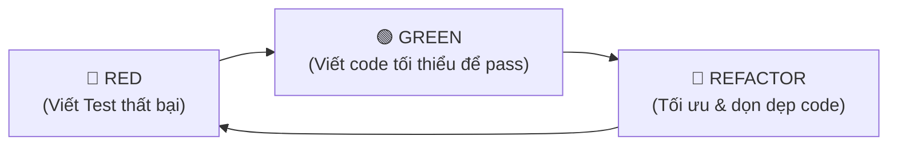

# Kỹ Năng: Test-Driven Development (TDD Superpowers)

Kỹ năng này ép AI phải tuân thủ kỷ luật kỹ thuật cao: **Bắt buộc viết kiểm thử tự động (Unit Test) và xác nhận test thất bại TRƯỚC KHI được phép viết code tính năng**.

---

## 1. Vòng Lặp 3 Bước TDD Bắt Buộc



### Bước 1: 🔴 RED (Viết Test Thất Bại Trước)
- Không viết code tính năng trước.
- Viết các test case mô tả hành vi mong muốn:
  - Trường hợp chuẩn (Happy path).
  - Trường hợp biên (Edge cases: null, chuỗi rỗng, số âm, mảng vượt giới hạn).
  - Trường hợp ném lỗi ngoại lệ (Error handling).
- **Chạy lệnh test và xác nhận kết quả là FAIL (đỏ).** Nếu test pass ngay từ đầu nghĩa là test vô nghĩa hoặc sai logic.

### Bước 2: 🟢 GREEN (Viết Code Tối Thiểu)
- Chỉ viết đúng lượng code vừa đủ để toàn bộ các test case ở Bước 1 chuyển sang PASS (xanh).
- Không viết dư thừa tính năng chưa được test định nghĩa.

### Bước 3: 🔵 REFACTOR (Tái Cấu Trúc An Toàn)
- Dọn dẹp code, loại bỏ trùng lặp, cải thiện tên biến và hiệu năng.
- Chạy lại test suite để đảm bảo mã tái cấu trúc không làm gãy bất kỳ bài kiểm tra nào.

---

## 2. Hướng Dẫn Tối Ưu Cho Từng Dòng Model

### 🌟 Dành cho Claude 3.7 / Antigravity / Cursor
- **Prompt mẫu:**
  ```text
  Theo skill `test-driven-development`:
  Tôi cần triển khai hàm [Tên tính năng]. 
  Hãy bắt đầu bằng việc viết toàn bộ Unit Test (Vitest/Jest) trước. Chạy test để chứng minh kết quả là RED, sau đó mới viết mã thực thi để đạt GREEN.
  ```
