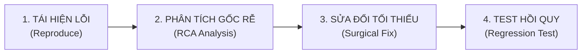

# Quy Trình Gỡ Lỗi & Xử Lý Sự Cố (Bug Fixing Workflow)

## Các Bước Triển Khai
1. **Thu thập chứng cứ:** Lấy stack trace, console log, payload mạng hoặc ảnh chụp màn hình UI.
2. **Kích hoạt skill `ai-debugging-loop`:** Yêu cầu AI phân tích lý do lỗi trước khi sửa.
3. **Áp dụng quy tắc `surgical-debugging-rules.md`:** Chỉ sửa đúng dòng code gây ra lỗi, không xóa code cũ.
4. **Viết test case ngăn lỗi lặp lại:** Thêm 1 test case kiểm tra trường hợp lỗi vừa sửa.
