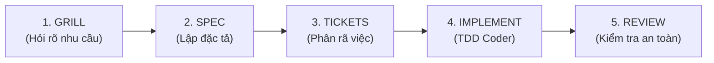

# Quy Trình Phát Triển Tính Năng Mới (Feature Development Workflow)

## Các Bước Triển Khai
1. **Khám phá:** Chạy `/grill-with-docs` hoặc `/brainstorming-socrates` để chốt phạm vi và danh sách "KHÔNG LÀM".
2. **Đặc tả:** Tạo file `SPEC.md` bằng `/to-spec`.
3. **Phân việc:** Tạo danh sách task bằng `/to-tickets`.
4. **Viết code:** Thực hiện từng task theo phương pháp TDD (`test-driven-development`).
5. **Nghiệm thu:** Rà soát lại qua `code-reviewer` trước khi commit.
