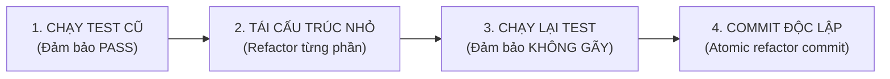

# Quy Trình Tái Cấu Trúc Mã Nguồn (Refactoring Workflow)

## Các Bước Triển Khai
1. **Kiểm tra trạng thái:** Đảm bảo test hiện tại đang PASS 100%. Nếu test đang fail, cấm không được refactor.
2. **Chia nhỏ:** Không bao giờ refactor cùng lúc 10 file. Chỉ refactor 1 module tại một thời điểm.
3. **Bảo toàn hành vi:** Refactor chỉ cải thiện cấu trúc bên trong, cấm thay đổi interface hoặc hành vi bên ngoài của API.
